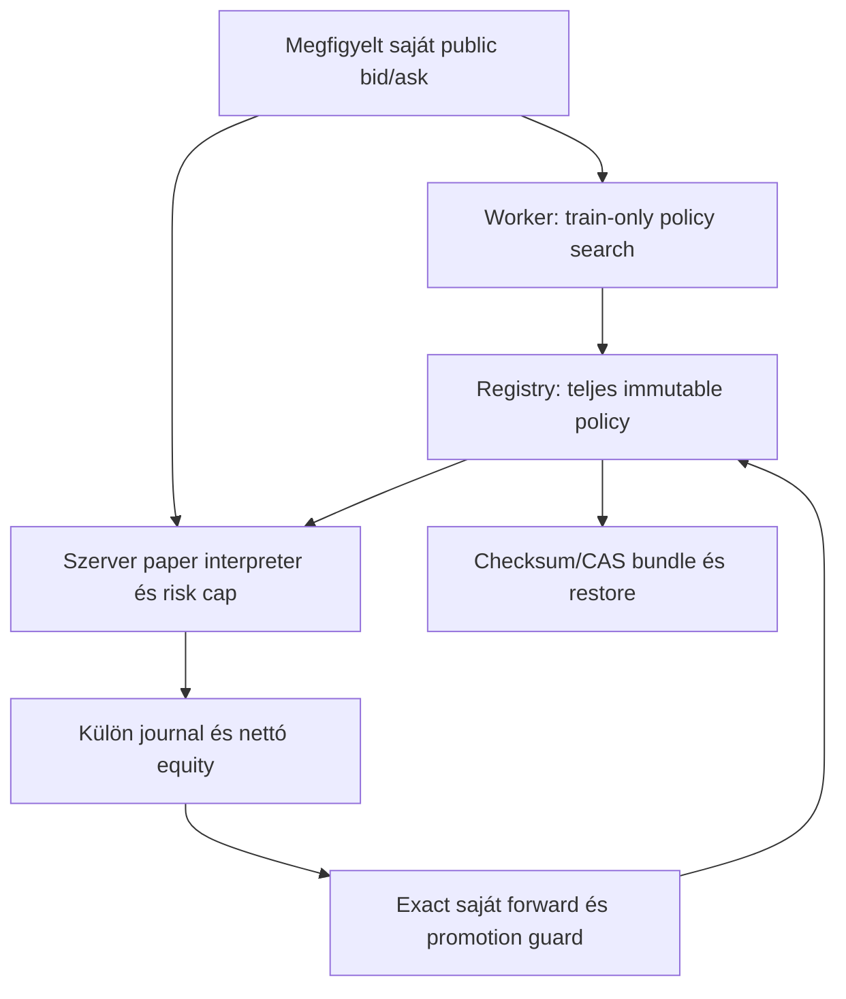
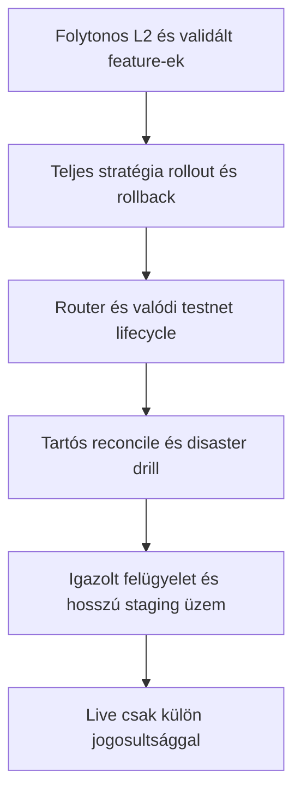
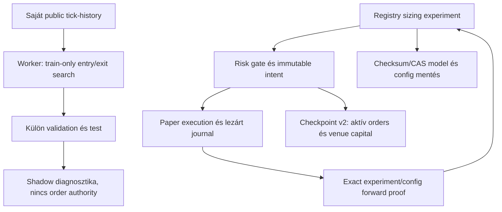
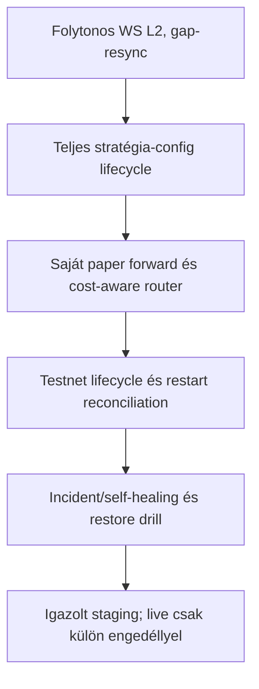
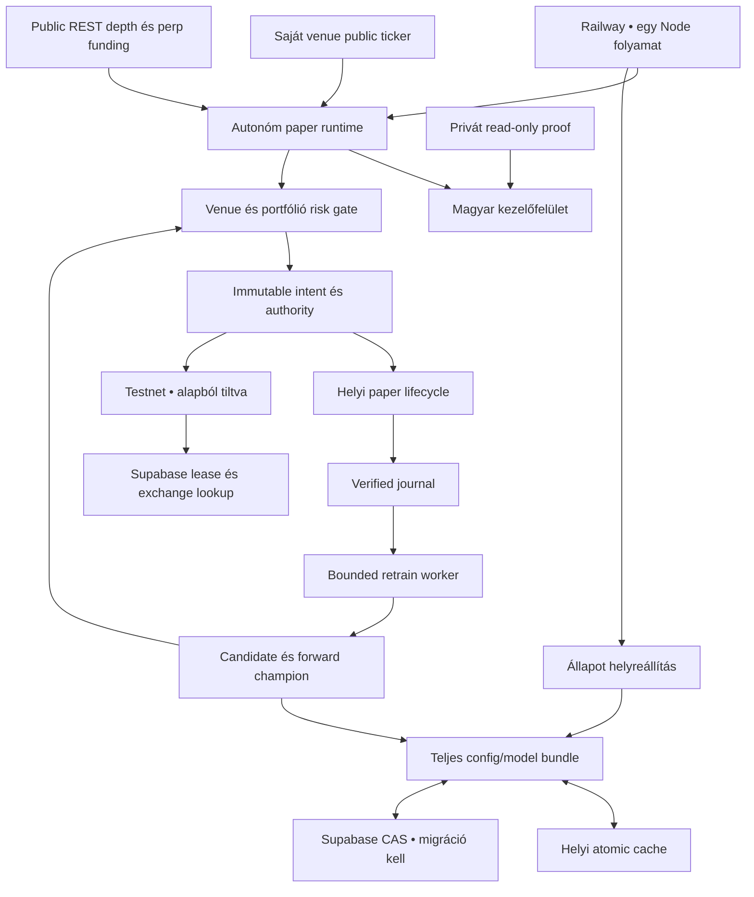
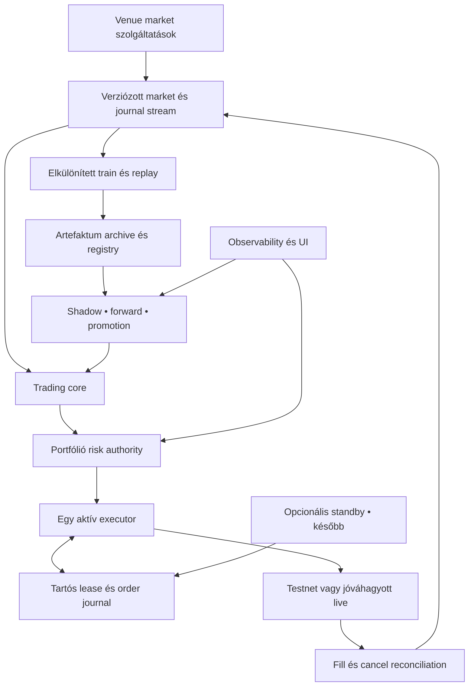

# NEXUS v199_187_16 – tényleges köztes fejlesztési kiadás, 2026-10-09

**A 100 pontos projekt nincs teljesen befejezve.** A megőrzött eredeti elfogadási feltételek szerinti állapot: **39 KÉSZ,55 RÉSZLEGES,4 HIÁNYZIK,2 KÜLSŐ FELTÉTEL MIATT BLOKKOLT**. Ez nem 100/100 és nem nyereségességi igazolás. A működő részeredmény és a következő feladatok teljes forrása ebben a ZIP-ben van. Nem állítunk új üzemi/testnet/Supabase/GitHub Actions sikert.

## Forrás és futtatás

GitHub main a connectorral és git fetch-csel ellenőrizve: `cf03a681b894375a24c34d61aa55506a5e0452f5` ([commit](https://github.com/Geistor/nexus-ai/commit/cf03a681b894375a24c34d61aa55506a5e0452f5)). A csatolt `NEXUS_v199_187_15(2).zip` SHA256 `ad6a8018c54941679ae4156899de95d7d9e3c5f193a437186fef3c7cca0181e4`,100 fájl. A ZIP összes forrásbájtja a mainnel azonos volt, kivéve a mainből hiányzó `.github/workflows/nexus-ci.yml` fájlt. Fejlesztési alap: ez a v15 main, visszaadott CI-workflow-val; a régi0.9.3 `nexus.zip` nem lett bekeverve. Indítás `npm start` → `node server.js`; Node20.x, tényleges helyi20.20.2; ws8.22.0; node:test regresszió, PGlite izolált SQL-tesztek, offline szerver smoke. Nincs GitHub push vagy Railway deploy.

## Mindkét videó tényleges vizsgálata

A12:10-es239.594s és16:35-ös117.422s felvétel teljes időtartama megvizsgálva másodpercenkénti képkockákon és olvasható kiemelt eredeti képeken. Ez diszkrét,1fps vizsgálat; másodpercnél rövidebb eseményt nem zár ki. Az alábbi idők a felvételek elejétől értendők.

| Videó / idő | Közvetlenül megfigyelt tény | Következtetés / korlát |
|---|---|---|
|12:10,00:00–00:03|Átmeneti PAPER/STAGING SAFE,0/12 piac és régi v12 böngészőcím; utána v15/12 friss piac|Startup/cache állapot; frontend verziókulcs valóban v12 maradt a v15 forrásban. V16 javítja.|
|12:10,00:03–00:30|Frissülő szerveridő,12/12 saját public piac; private végrehajtás Binance; verified főmérők nettó−$3,WR11.1%,DD0.03%|Public kapcsolat nem private order vagy testnet fill bizonyíték.|
|12:10,00:26–00:54|Folyamatos HOLD/vételi döntés, konkrét momentum/cost/alignment/walk-forward elutasítások|A ciklus nem látszik teljesen befagyottnak; a kapuk feloldása nélkül nincs indokolt entry.|
|12:10,00:51|Korábbi sleep-is-not-defined incidensek **helyreállt előzmény** címkével; helyreállítás12:10:53|Nem új v15 sleep hiba; a forrás timers/promises importja már létezik. Nem jelentjük új javításként.|
|12:10,01:18–01:39|Registry13 candidate,0 validated/champion, minden sor0 saját forward/PF0; remote-unavailable|Teljes saját entry/exit experiment hiányzó bekötése forrásban igazolt. Távoli mentés hiányát helyi teszt nem oldja meg.|
|12:10,01:18–02:28|Előnézet nélküli simulation figyelmeztet; majd preview és valódi SVG graph elkészül|Builder shadow funkció; nem valódi kereskedés.|
|12:10,02:46–02:54|Kockázatcsökkentés0.55,8 ismert minta,aktuális új20-hoz0; quality35%; confidence88% ésWR11.1%|Confidence nem találati arány. Az UI két külön mutatót mutat.|
|12:10,03:25–03:59|Private Binance, Bybit nem private-connected; learning panelek ritka mintával|Saját public Bybit adat lehetséges; Binance privát kapcsolat nem ruház át jogosultságot.|
|16:35,00:00–00:08|Aktuális process51 lezárt, összes ismert1649; korábbi felvételben31 és1629|A két felvétel kijelzett számlálói között20 új lezárás. A köztes4h25m folyamatos futását nem láttuk; nem állítjuk, hogy nem volt kereskedés.|
|16:35,00:24–00:33|Régi sleep incidensek helyreállt előzményként, helyreállt16:35:33; új döntések konkrét blokkokkal|Nem visszatért sleep hiba.|
|16:35,00:40–00:52|Registry19 candidate,0 validated/champion; sajátforward0; teljes aggregate1411/11.1%, részletes349/7.7%;1359/1598 counter védelem|Eltérő adatscope és részleges restore. Pontos teljes egyezéshez teljes éles journal read szükséges, nem mesterséges számláló-javítás.|
|16:35,00:58–01:19|Magyar Builder preview/SVG/shadow simulation válasz és toast|UI interakció működik; nem full strategy deployment.|
|16:35,01:24–01:39|Régi order/fill/journal kártyák és lezárttrade lista görgetése|Történeti adatok; nincs megfigyelt új fill a rövid szakaszban.|
|16:35,01:40–01:57|Profit Vault239 trade, külön paper venue kasszák~2499.98–2499.99, fő equity9997|A vault és verified aggregate eltérő mintája/módja nem vonható össze. Tényleges pénztranszfer nem látható.|

Nincs videóval igazolt deploy/restart drill, actual testnet fill, külső DB restore vagy többórás végig megfigyelt stabilitás. A kijelzett1321perc uptime önmagában nem ilyen drill.

## Implementált működő változások

- `continuousRetraining.advanceEntryExit`: közös, múltadatot használó entry/exit interpreter; következő quote ask belépés, bid kilépés, kétoldali díj/slippage, stop/TP/holding, lot/min-notional, duplicate/out-of-order kizárás. Replay nem zár fiktíven pozitív terminális pozíciót.
- `modelRegistry.registerPaperStrategy/paperStrategyTick` és szerver boot/timer: train-only replay nyertes teljes immutable policy/configja önálló paper kísérletben fut, böngészőtől függetlenül. Legfeljebb12 aktív kísérlet,250USD külön virtuális keret,25USD vagy saját equity10%-a a notional felső határa,10USD drawdown cap,2000 lezárt journal/kísérlet után leállás. Nem fő számla tőkéje/PnL-je és nem tőzsdei fill. Sizing-kísérlet nem éhezteti ezt a külön entry/exit kísérletet.
- Új quoteObserved jelölés: csak valóban megfigyelt bid/ask, saját venue/symbol,15s-on belüli public quote indíthat új paper életciklust. Árhoz visszapótolt bid/ask nem válhat verified paper eredménnyé. Stale, synthetic, cross-venue, holdout, kill/manual stop és live mód blokkol. Gap után első friss quote védelmi close lehet, de nem verified forward bizonyíték.
- Registryben teljes paper pozíció/ablak/pending/decisions/journal/realizált nettó equity marad; fsync+atomic rename+checksum. Sérült létező fájl nem fordul üres registryre. Exact experiment/config tags, saját30 forward/PF1.15/expectancy>0/reliability0.5 guard marad. Own negatív recent30 paper stratégia visszavonható; teljes modell/config és tőzsdei rollout még részleges.
- Opcionális, nyitható magyar Registry sorok: paper scope, állapot/blokkoló ok, utolsó saját quote, nyitott pozíció, külön keret/PnL. Fő layout/bal konzol/alsó sáv megmaradt. Frontend release/cache keys v16-ra javítva.
- Saját sűrű, lezárt quote-gyertyák pattern feature-je és díjas buy-and-hold referencia külön API-n. A pattern megfigyelés része a tényleges preview technikai adatának; scoreAdjustment0 és nincs belépési authority. External leader feed/out-of-sample pattern bizonyítás még nincs.
- Meta-supervisor allocation delta audit: ajánlás és megfigyelt risk-budget változás elkülönítve, venue/ok/score/dátum, bounded200 rekord, API-ban elérhető. Nem pénztranszfer.
- Opcionális Redis REST TTL/version/checksum monitoring cache és privát Supabase Storage hash-addressed, immutable modell/bundle archive, tényleges szerver timerbe kötve. Nincs új szolgáltatás létrehozva; nincs fizetős migráció; konfiguráció nélkül nem használ külső cache/archive-ot. Mock readback teszt nem külső proof.

## Megismételhető ellenőrzés

```bash
node --version
npm ci --ignore-scripts
npm run check
npm run release:test
NEXUS_SMOKE_HEADLESS_MS=40000 npm run test:smoke
npm start
```

Minden új teszt csak ideiglenes könyvtárak fixture adatait használja; nem ír az üzemi journalba és nem bizonyít profitot. Megtartott teszt nem lett kikapcsolva vagy gyengítve. A smoke tiltja az outbound HTTP/fetch és a private/live/testnet submit útvonalakat. A helyi clean-release parancsok tényleges ideje az alábbi ellenőrzési naplóban szerepel.

## Telepítés / rollback / külső acceptance

1. A ZIP `nexus` mappájának **tartalmát** töltsd a repository gyökerébe. A `.github/workflows/nexus-ci.yml` rejtett mappát külön ellenőrizd; GitHub webes feltöltés korábban kihagyta. `storage` fájlokat ne törölj, titkot ne tölts fel. Telepítés előtt létező tartós mentést őrizd meg.
2. Node20; Start=`npm start`; egy Railway replica; Serverless OFF; PAPER alapértelmezés; LIVE és real testnet submit maradfalse. A jelenlegi változókat őrizd meg; nincs automatikus új paid service.
3. A gyors egészség `/healthz`;30s után `/api/strategy/paper-experiments`, `/api/models/durability`, `/api/models/infrastructure`. A régi quote-history még nem tartalmaz quoteObserved jelölést: új valódi minták gyűlnek. Search15percenként, legfeljebb4 legnagyobb saját quote-scope-ból; kell90 quote és embargo után legalább20/20 validation/test. Insufficient adatnál nem készít sikeres kísérletet. A kiválasztott család jelzése és friss quote hiánya esetén nem erőltet trade-et.
4. A v13 learning-state/authority SQL-migráció **kizárólag jelölt BEGIN/END szakaszát** alkalmazd ellenőrzött staging DB-n. A teljes régi toolboxban lehet destruktív repair; a teljes fájlt ne futtasd vakon. Ebben a kiadásban nincs új SQL vagy éles migráció.
5. Külső Supabase acceptance: `/api/models/durability` remoteVerified; legalább1 own paper close; mentett experiment/config/position/journal/equity hash; restart után összehasonlítás, azonos tick ne hozzon létre új trade-et. Először elkülönített stagingben teszteld a teljes crash/partial-write/CAS conflict kört; éles adatot ne törölj.
6. Opcionális cache: saját meglévő Redis REST szolgáltatáshoz `NEXUS_REDIS_REST_URL`, `NEXUS_REDIS_REST_TOKEN`. Archive: meglévő privát buckethez `NEXUS_ARCHIVE_BUCKET` és server-only `SUPABASE_URL`/`SUPABASE_SERVICE_ROLE_KEY`; kulcs nem frontendbe. Readback hash után verified státusz. Nincs natív Redis/Valkey socket adapter, nincs R2/S3 provider adapter, nincs archive retention/delete automatizálás; ezek az eredeti célban részlegesek.
7. Actual testnet acceptance még szükséges: sandbox keys + account balance + exchange precision/rules; submit/partial fill/cancel/timeout/restart reconciliation; bizonytalan megbízást resubmit helyett reconciliálni. A mostani local-paper teszt nem ilyen bizonyíték.
8. Fix outbound IP, külön Railway staging, CI provider gate, többprivatevenue és többórás/napos üzem külső hozzáférést/megfigyelést igényel. Standby/arbitrage cluster/multi-service/profit-vault egyszerűsítés nincs elkészítve. A mátrix összes további részleges modulja konkrét fennmaradó feladat.
9. Rollback: ismert v15 forrás és a hozzá tartozó megőrzött tartós mentés; állítsd le a service-t, majd egy replica újraindítás előtt ellenőrizd a verziót és a nyitott order/reconciliation állapotot. V16 adatait ne töröld csak azért, hogy v15-tesztet futtass. Éles rollback drill nem történt.

A dokumentáció elsődleges adapterreferenciái: [Redis REST API](https://upstash.com/docs/redis/features/restapi), [Supabase standard upload](https://supabase.com/docs/guides/storage/uploads/standard-uploads), [privát storage access control](https://supabase.com/docs/guides/storage/security/access-control). A changelog markdown fetch content-type miatt nem volt olvasható; a releváns hivatalos upload/access-control dokumentáció ellenőrizve.

## Munkamenet-checkpoint

A teljes100 pontos cél további fejlesztést igényel. A megmaradt teljes követelmények és elfogadási feltételek a REQUIREMENTS_MATRIX_1_100.md minden eredeti sorában, a következő munkamenet feladatai annak végén vannak. A fenti új full-policy paper kör használható részeredmény, nem a teljes kereskedési OS befejezése. A korábbi v15/v14/v13 szakaszok alább történeti anyagok, nem új v16 bizonyítékok.

## V16 aktuális architektúra



## Fennmaradó célarchitektúra



A monitoring snapshot a paper journalból csak az utolsó10 ügyletet és a teljes darabszámot adja át; a teljes journal a durable registryben megmarad. Így az új rész nem küldi minden dashboard/SSE snapshotban újra a teljes kísérleti történetet. A modelRegistry helyi serialize/fsync terhelésének többnapos, nagy journallal történő mérése még nincs meg.


---

# V199_187_15 audit és köztes kiadás – 2026-10-08

Kiinduló commit: `fa3746daf745f51d8787bb4b9ed4678b436303e0`. Git fetch ellenőrizve. Csatolt v14 ZIP SHA256: `b58fc54d3f75c7fbebfdc5f08e92ea72bf3ad5c812c0e3eaae66884c8b9556a7`,100 fájl, megegyezett a korábbi átadással. A GitHub commit99 fájlt tartalmazott; `.github` workflow hiányzott. A v15 újra tartalmazza,100 fájlos kiadásban, modul vagy teszt törlése nélkül.

## Új videó értékelése

`Desktop 2026.10.08 - 17.50.44.01.mp4`,21.318 s. Teljes időtartam vizsgálva másodpercenkénti képkockákon.

| Idő | Közvetlenül látható | Következtetés / eldöntendő |
|---|---|---|
| 00:00–00:03 | ChatGPT beszélgetés; v13/v14 csomag és státuszlista | Fejlesztési beszámoló, nem bot runtime |
| 00:04–00:15 | A100 pontos lista görgetése | Nem bizonyít modulfutást, kereskedést vagy restore-t |
| 00:16–00:19 | Lista vége, következő prioritás | Nincs új Railway-, journal- vagy tőzsdei adat |
| 00:20–00:21 | Felvevő overlay | Nincs további alkalmazásbizonyíték |

A korábbi152.833 s v12 alkalmazásvideó auditja a dokumentum korábbi részében maradt. A v12 veszteséget/hibát nem állítjuk automatikusan a v15 aktuális hibájának.

## Bizonyított ok → javítás → ellenőrzés

| Ok a forrásban | V15 változás | Helyi ellenőrzés |
|---|---|---|
| Forward szűrés csak artefaktum alapján; új trial ugyanazt az artefaktumot használhatja | Új modellek exact experiment/config bindingja a sizing→sealed intent→journal láncon | azonos artefaktumú parent/trial, rossz config, synthetic/future kizárás |
| Remote GET hiba üres listára fordul | Strict read; remote unavailable külön állapot, nincs feltételezett rev0 írás | 503 és legacy nem strict read elkülönítése |
| Azonos registry-revízió eltérő configja nem ütközött | Bundle shape/revision/duplicate/status ellenőrzés; config conflict | célzott bundle konfliktus teszt |
| Folytonossági checkpoint nem mentett külön aktív ordereket | v2 checksum + partial lifecycle + venue capital; closed-order és uncertain-submit védelem | partial remainingQty, terminal order, journal exclusion, checksum visszautasítás |
| Worker exit0 üzenet nélkül függő Promise maradhatott | Settled flag és exit-without-result hiba; minden ág felszabadítja időzítőt | teljes regresszió + worker replay determinisztikus egyezés |
| Korábbi search csak már meglevő trade-ek sizingját játszotta vissza | Külön quote-path entry/exit engine,9 variant, saját quote-scope, fees/lot/holding/nyitott pozíció | eltérő család eltérő entry, fee sensitivity, prefix causality, holdout perturbáció, worker |

## Ellenőrzések és korlátok

- Kiinduló v14 újrafuttatás:137/137 PASS.
- Tiszta ZIP-kibontás: `npm ci --ignore-scripts`, `npm run check`, `npm run release:test`, `npm run test:smoke` mind sikeres,145 teszt,0 hiba; tesztidő2865.671 ms.
- V15:145/145 PASS; Node20 szintaxis; offline smoke18 GET és új replay POST/invalid revalidation POST. Outbound network tiltva a smoke alatt.
- A megtartott izolált PostgreSQL teszt futtatta a v13 CAS/lease/grant és backup–helyi törlés–restore körét. A modell/config restore helyileg igazolt, nem egy teljes Railway disaster recovery.
- Négy actual public spot depth URL lekérése megkísérelve: Binance/Bybit/OKX/Kraken mind `EAI_AGAIN` DNS hibával blokkolva. Nem volt szolgáltatói payload, fill vagy testnet kulcs használat.
- Railway/GitHub Actions/CI-várakozás szolgáltatói beállítása nem módosítva. Repository push nem történt. Valódi testnet lifecycle, folyamatos WS L2 és automatikus uncertain-order reconciliation továbbra is hiányos.
- A quote replay nem teljes stratégiakonfiguráció lifecycle: shadow diagnosztika API; nincs runtime entry/exit winner aktiválás vagy Registry promotion. A régi sizing experiment működése megmarad. A9 trial korrekció független korlátos célfüggvényt feltételez; időfüggő mintákra nem hozamgarancia.
- Quote replay spot long only, legfeljebb4000 tick. Snapshot quote tickeket használ, nem OHLC-t vagy orderbook queue-positiont. Funding spot N/A; perp execution nincs. Gapon nyitott pozíció megáll és külön kerül kimutatásra, nem kész profitbizonyíték.

## Aktuális architektúra



## Következő célarchitektúra



A teljes100 pontos hatókör megmaradt; nincs pusztán tesztszám alapján készre emelt pont. A v15 az első két prioritás javításait és egy további kutatási komponenst ad át köztes kiadásként.

Az alábbi v14/v13 anyag történeti rész; a fenti v15 szakasz az aktuális.

# NEXUS AI v199_187_14 – kiadási és bizonyítási dokumentáció


## v14 tényleges folytatás – 2026-10-08

Kiinduló munka a már elkészült v13, változatlan GitHub main `1189f26c5d1aad256cc244e1e5d608569f988a2a`. A frissen csatolt nexus.zip package verziója0.9.3, régi backend belépési ponttal; nem váltottuk vissza erre a korszerűbb rendszert. Új verzió v199_187_14, build forward-policy-search-risk-core. A stratégiaepoch és PAPER/LIVE szabályok változatlanok.

### Új működő integráció

1. **Bounded search valós kiválasztással:** a6 sizing/score-threshold változat kizárólag trainből készül. A family-wise `alpha=0.05`, `K=6` korrekció ténylegesen levonódik az objective-ból: `2B × sqrt(log(K/alpha)/(2n))`, B=$10 előre rögzített clipping bound. Az objective a [-10,10] tartományra clipped átlag és DD-penalty; nem a teljes pénzügyi PnL helyettesítője. A Hoeffding bound független mintákat feltételez, az időbeli függőséghez külön forward proof kell. A nyertest train objective választja; a validation/test nem választ új nyertest vagy súlyt. A befagyasztott nyertes tényleges experimental artefaktum lesz, külön holdout metrikával, és legfeljebb1 riskHinttel fut. Gyenge kísérlet adatot gyűjthet, nem kap risk boostot.
2. **Közös promotion policy:** Registry, venue-agent és quality autopilot ugyanazt a registryPromotionPolicy függvényt használja. Aggregált champion mellett is legalább30 saját mode/venue/route nettó pozitív forward minta/PF/reliability kell; Binance eredményből Bybit nem kap jogosultságot. Shadow ranking megmarad, nem risk champion. A teljes tetszőleges stratégia-config és entry/exit család promotion még nem kész.
3. **Auditált újraértékelés:** openRevalidationTrial retired modellből friss paper trialt készít. Nem örökli validation/prospective/risk jogosultságát; saját új időhatár+60s embargo, új trial-id, parent revalidationOf és esemény. Ismételt kérés idempotens. A régi retired entry megmarad és decay-retired modell nem közvetlen rollback cél. Trial queue nem szakítja félbe a már futó experimentet.
4. **Portfolio2 friss korreláció:** saját venue10s bucket/48return, legalább20 aligned minta és60s freshness; marketSeriesHistory saját public adataiból. Ismeretlen/stale/ritka correlation1. Per-venue és global correlated exposure gate; a tőke továbbra is venue-izolált. A globális risk nem tőkeátutalás vagy cross-venue borrowing.
5. **Compounding integrációs hiba javítva:** az50 mintás feltétel v13-ban24 soros rövid ablakból értékelődött, így nem lehetett jogosult. Most a rövid activity/quality ablak mellett külön legfeljebb200 saját venue lezárás jut az equity policyba. Dedup, valid timestamp és azonos candidate/mode szűrés; CURRENT equityből helyes kezdőtőke/DD rekonstrukció. Negatív/kevés mintán nincs boost.
6. **Nyitható magyar részletes nézet:** legutóbbi modellek, experiment, forward/PF, durability, policy search, risk és equity, audit eventek; retired revalidation gomb. A konzol/státuszsáv fő szerkezete megmarad. Az accordion nyitottságát a UI állapot megőrzi; label escape tesztelt.
7. **Tényleges public REST-adapterek:** backend/services/marketData.js a meglévő funkciókat megőrzi és public depth/funding cache-t ad. Binance/Bybit/OKX/Kraken spot depth; Binance/Bybit/OKX USDT perp funding és depth. Külön termék/venue/symbol cache-kulcs, szigorú shape/symbol/rendezés/crossed/stale validáció, explicit provider error és60s backoff. Depth3s/funding60s freshness. Max24piac,2párhuzamos GET,3s/request,15s ütemezés,10s browserfüggetlen tick. A core csak cache-t olvas, nem vár a pollra. Nem aktivál perpetual tradinget, private kulcsot, pénzmozgatást vagy live submitot.
8. **Funding null bug:** a JavaScript Number(null)=0 miatt a hiányzó perp adat korábban validált nulla rate-ként jelenhetett meg. Null/üres/hiányzó rate most explicit missing; spot továbbra is N/A. Hiányzó basis null marad.

A depth **teljes REST snapshot**, nem folytonos WS delta stream. A snapshot-id-k ugrását nem nevezik sequence-gapnek; delta gap szabálya megmarad. Binance/Kraken timestamp nélküli REST könyvnél `timeBasis=receipt-no-provider-event-time`, nem állítjuk, hogy exchange event timestampet kaptunk. A snapshot frissessége rövid TTL és receipt/provider timestamp alapján mérhető; folyamatos sequence/checksum WS fejlesztés még szükséges.

### v14 bizonyítás

Node20.20.2: **137/137 regresszió PASS**, szintaxis PASS és offline smoke PASS. A10 új teszt a search selection/holdout/correction, own-route/mode policy, friss revalidation és remote-bundle restore, korreláció freshness/global risk, helyes equity sampling/DD, UI escape, négy venue REST-parser, null funding/crossed/stale/wrong-symbol blokk, cache TTL/concurrency/backoff eseteket bizonyítja. A korábbi127 teszt megmaradt. Offline17 GET route + safe-content/no-compounding/retrain és invalid revalidation409 assertions. Minden outbound hálózat blokkolva, public edge poll külön disabled.

A feed-tesztek rögzített API-response fixture és fake public transport segítségével futnak. **Valódi Railway/L2/funding szolgáltatói futási proof nincs**, HTTP200 vagy implementált adapter nem helyettesíti. Production DB-migráció, GitHub push/Actions run, Railway CI gate és real-testnet drill továbbra is külső feladat. A v14 ugyanazt az additív v13 SQL-szakaszt használja; új SQL nem kell. A teljes100 pont nincs befejezve: további entry/exit stratégia családok, continuous WS L2, object/archive/cache/failover és más hiányzó integrációk megmaradtak a mátrixban.

### Adapterforrások – hivatalos dokumentáció, ellenőrizve 2026-10-08

- [Binance spot order book](https://developers.binance.com/en/docs/catalog/core-trading-spot-trading/api/rest-api/market) és [USDT futures market data](https://developers.binance.com/en/docs/catalog/core-trading-derivatives-trading-usd-s-m-futures/api/rest-api/market-data).
- [Bybit REST orderbook](https://bybit-exchange.github.io/docs/v5/market/orderbook) és [tickers/funding mezők](https://bybit-exchange.github.io/docs/v5/market/tickers).
- [OKX API guide](https://www.okx.com/docs-v5/en/) – market/books és public/funding-rate.
- [Kraken REST orderbook](https://docs.kraken.com/api-reference/market-data/get-order-book).

## Megőrzött v13 alap, videóértékelés és szakmai korlátok

Az alábbi v13 eredmények történeti alapbizonyítékok. A v14 fenti változásai felülírják a search „diagnostic-only”, a hiányzó friss correlation bekötés és a hiányzó REST feed implementáció korábbi állításait. Az eredeti videó ugyanaz a v12 futás, új videó nem érkezett.

Dátum: 2026-10-08. Kiinduló repository: https://github.com/Geistor/nexus-ai, main commit `1189f26c5d1aad256cc244e1e5d608569f988a2a`, v199_187_12. Új verzió: **v199_187_13**, build `validation-recovery-authority-core`, Node20.x. A stratégiaepoch `v199_187-adaptive-exit-ai-core` megmaradt, nem indítottunk új PnL-epochot.

A kiadás ZIP-ben készült; GitHub push, Railway deploy, production Supabase migráció, real-testnet vagy LIVE művelet nem történt. Az aktuális forrásból ténylegesen hiányzott a dokumentációban említett CI fájl. A meglévő main forrását újra teszteltük: szintaxis PASS, **109/109 regresszió PASS**, offline startup PASS.

## Tényleges szerkezet és funkciómegőrzés

Az eredeti git forrás 98 fájl. A csomag rootja `nexus/`; belépési pont `server.js`, magyar UI `frontend/index.html`, `frontend/app.js`, `frontend/style.css`. A futó döntési/végrehajtási/persistence integráció továbbra is a szerverben található; a `backend/services` modulok adják a policy-kat, guardokat és metrikákat. Az infrastruktúra SQL `infra/supabase_tools.sql`, a tesztek `tests/probe-regression.test.js` és `tests/offline-smoke.cjs`.

Megmaradt az Adaptive Exit AI, Scorecard, Registry, Retraining, Quality Autopilot, Position Lifecycle, Evidence Sizer, Agent Mesh, Meta-Supervisor, Execution Intelligence, Market Intelligence, Simulation Lab/MC, Global Learning Coordinator, microstructure/funding scorer, Strategy Builder/szimuláció és self-healing. A megtartott 109 alapteszt és az új tesztek együtt futnak. A fix bal konzol, magyar felület és kompakt státuszsáv struktúráját nem alakítottuk át.

A fájllimithez az önálló, runtime által nem importált legacy core tartalma a meglévő `backend/core/nexus-kernel.js` **legacyCore exportjába** került. A kód és exportált funkciók megmaradtak. Új fájl a `backend/services/executionAuthority.js`, `.github/workflows/nexus-ci.yml` és `package-lock.json`. Összesen **100 valódi fájl**, nincs csomagolt `.git`, `node_modules`, runtime cache, credential vagy felhasználói videó. Üres könyvtár nem számít fájlnak.

## Videó: időbélyeges megfigyelések

Forrás: a mellékelt `20261008-1012-49.1241254.mp4`, hossz152.833s. A teljes időtartamot másodpercenkénti képkockákkal átnéztük, a panelrészleteket nagyobb képeken is ellenőriztük. Az alábbi idősávok képernyő-megfigyelések; nem szerveroldali trace vagy független production API mérés. A videó v12-et mutat, nem az új kiadást.

| Idősáv | Közvetlenül látható | Következtetés / ellenőrzési korlát | v13 intézkedés |
|---|---|---|---|
| 00:00–00:03 | v12, futó AI; uptime körülbelül924perc; process32 lezárt, WR6.3%, nettó összes virtuális eredmény -$2.97 | Heartbeat/UI-frissülés látható; újraindítás automatikusságát ez nem bizonyítja | Browserfüggetlen startup megmaradt; külön offline indulási próba |
| 00:04–00:09 | Négy venue külön paper kasszával és public adatállapottal; Binance private API OK, mások tanulási kapcsolat | „Tradeable” helyi szimulációra vonatkozik, nem négy valódi privát kapcsolat | Felirat: „Helyi tanulási tőzsdék”; jogosultságok elkülönítve |
| 00:10–00:16 | Venue seed egyenként$2500; aggregate equity$9997.03; paper1593, verified1385, kizárt3294; verified WR10.6%; látható részletes192 sor PF0.04/WR4.7% | A különböző táblák mintaköre és epochja eltér; a számok nem összeadhatók; nem profitábilis bizonyíték | Train/holdout/mode szétválasztás; nincs historical alapján risk champion |
| 00:17–00:21 | Vault/indulási és helyreállítási panelek | Mentett state nem bizonyított cache nélküli restore | Teljes model+config remote bundle és elkülönített törlés–restore teszt |
| 00:22–00:31 | Local staging számláló682/20 és zöld fallback proof; safe staging mód | Local proof nem külső testnet order/fill | Live promotion proof feltétele valódi TESTNET_ORDER_ACCEPTED+real mode; fallback nem eligible |
| 00:32–00:40 | Read-only/live readiness panelek; live real submit és allow kapcsolók tiltottak | Private read nem submit jogosultság | Live lock megmaradt; külső submit durable authorityt igényel |
| 00:41–01:00 | Read-only proof próbák/recovery párbeszéd; policy-disabled live-read proof mellett normál Binance read elérhető | Nem azonos útvonalak; a tiltott extra live-proofból nem következik, hogy a normál signed read hibás | Meglévő credential/read útvonal megőrzése; nincs titokmásolás vagy kulcsfelülírás |
| 01:01–01:19 | 12/12 saját friss public piac, runtime/DB/readiness panelek | Feed freshness látható; L2 depth/perp funding nem bizonyított | Scorer és élő feed külön a mátrixban; nincs fabrikált depth/funding |
| 01:20–01:29 | Continuity „saved-local-remote-deferred”, kezdeti local+remote státusz után | Átmeneti remote halasztás látható; nem mondható végig teljesen egészségesnek | Durable v3 státusz külön; checksum/CAS conflict/write-blocked explicitté téve |
| 01:30–01:34 | Incident: **„Supabase auto-recovery hiba: sleep is not defined”** | Bizonyított retry-útvonal hiba; a teljes root hálózati ok nem látszik | Hiányzó timer import javítva; failed range read→bounded backoff→siker valóban futtatva |
| 01:35–01:40 | Runtime heartbeat zöld; nincs látható aktív runtime error; shape repair65 | Nem látható crash; javítások száma nem önmagában stabilitási proof | Worker és guard tesztek; nincs v13 többórás stabilitási állítás |
| 01:41–01:58 | Candidate24, validated0, championnincs; confidence bins77–94.8% mellett valódi bin WR0–5.7%; Builder előnézet még üres | A confidence nem kalibrált nyerési valószínűség; tanulás nem champion proof | Forward-only risk minősítés, stable experiment, tényleges SVG graph |
| 01:59–02:11 | Learning/lifecycle és modulrészletek, gyenge minőségi eredmények | Modulfelirat nem teljes integrációs acceptance | Megőrzött109 regresszió + célzott új invariánsok |
| 02:12–02:22 | Portfólió/credential állapotok, külön venue kasszák | Privát jogosultságokat nem szabad public coverage-ből levezetni | Portfolio Risk2 saját venue equityből; nincs cross-venue hitel |
| 02:23–02:32 | Uptime kb926perc; continuity remote-deferred ismét; latest20 WR5%, loss streak12; kb2.1 process trade/óra; nincs látható nyitott paper position | A videó alatt nincs bizonyított új order→fill→close; nincs friss deploy/restart drill | Micro-probe adatgyűjtés megmarad, rossz eredmény nem risk boost; üzemi drill még kell |

Független production API-lekérésből nem keletkezett hitelesített futási bizonyíték. A videó címsorából nem sikerült megbízhatóan igazolni az aktuális publikus szolgáltatás végpontját; ezt nem helyettesítettük a helyi HTTP200 eredményekkel. Production napló/export nem volt csatolva. A hosszú videóban látható uptime a v12 meglévő folyamatának részleges bizonyítéka.

## Változásjegyzék és szakmai korlátok

### Tanulási helyesség

`backend/services/continuousRetraining.js`: a route weights/artifact **csak trainből** készül. A trade sorok rendezése időrendi és determinisztikus; dedup, mode/epoch szűrés, pozíció nyitás/zárás overlap purge és60s embargo. A névleges70% train/15% validation/15% test arány a purge miatt változik; kevés mintán a ciklus kihagyhat, nem tölti vissza jövőadatból a train részt.

Az artefaktum befagyasztott sizing policy. Validation/test ugyanarra a történeti belépés/kilépés döntéssorra alkalmazza a tényleges route riskHint mennyiségarányát és arányos nettó költség/PnL-t. Más riskHint mérhetően más replay eredményt ad. **Nem teljes counterfactual új belépés/kilépés replay**, nem modellezi újra a minimum fee/lot részleteket, és `tradingEvidence=false`. Emiatt e replay nem ad champion risk jogosultságot. A default új policy riskHint<=1. Az untouched test policy-kimenetet használja a seeded Monte Carlo; max400iteráció. A teljes journal Scorecard csak diagnosztika, nem tanító artefaktum.

A fingerprint érdemi trade-id/idő/venue/symbol/regime/side/strategy/mode/epoch/quantity/net/cost tartalmat, train datasetet, configot és artefaktumot azonosít. Wall-clock createdAt/generatedAt nem képez új candidate-et. PnL-korrekció változtatja a megfelelő dataset/fingerprintet. Azonos tartalom regisztrációja kihagyás. Az állapot-időbélyegek az auditban megmaradnak.

A kijelölt `experimentId` megmarad legalább30 saját forward lezárásig; új candidate-ek gyűlhetnek shadow registryben. A policy a végső micro-probe mennyiséget is módosítja; az ügyleten `candidateFingerprint` és ténylegesen alkalmazott `candidatePolicy` szerepel. Csak azonos mode/epoch, holdout+embargo utáni, verified/reconciled, nem kizárt, deduplikált saját címkézett sorok képeznek forward bizonyítékot. Legalább30 sor, PF>=1.15, expectancy>0, reliability>=0.5 kell risk championhoz. Ez mérnöki elfogadási küszöb, nem jövőbeli profitgarancia. Az operational entry/exit guardok továbbra is hatnak; a mért candidate szűk sizing-policy szerepét kell értelmezni, nem önálló kereskedőként.

A régi venue champion/challenger shadow ranking megmaradt, de kockázatnövelési jogosultsága a forward-qualified Registrytől függ. Teljes stratégia-config/state-machine egyesítés még nincs. Strategy decay csak matching forward mintán: utolsó30 negatív expectancy/PF<0.9 esetén auditált retirement. Rollback nem hozhat vissza decay miatt retired vagy nem eligible modellt. Több ablakos statisztikai drift és auditált újraengedési kísérlet még továbbfejlesztendő.

### Worker, search és runtime

Retrain artefaktum/MC/search valódi Node worker threadben fut: max4000sor,128MiB heap,10s timeout; registry-write a fő szálon. A parent timer futását külön teszteltük. Nem egy async/setImmediate wrapperre alapozzuk a nonblocking állítást.

Bounded search:3 risk scale ×2 score threshold =6 train-only, seeded/reprodukálható változat; többszörös kereséshez explicit `sqrt(2 log6)` penalty diagnosztika, shadow-only. A winner nem telepített policy és nincs risk authority; külön validation/forward selection kell. Új entry/exit mutáció nem készült. Más nagy historical backtest/szimuláció/maintenance útvonalak teljes worker auditja még #60/#79/#95 munka; nem állítjuk, hogy az egész monolit minden CPU-terhelése megszűnt.

A Supabase retry a `node:timers/promises` timerét importálja. Range read max4próba, bounded backoff; count request meglévő retry útjai ugyanazt a definiált timert használják. A videó bizonyított ReferenceError megszűnt, az alap külső hálózati/DB hibák további üzemi vizsgálatot igényelnek.

### Tartós modell és konfiguráció

A registry v3 atomic helyi write, teljes entries/events, champion/previous champion/experiment és revision mezővel. `exportDurableBundle`/`verifyBundle` tartalmazza az összes candidate/validated/retired artefaktumot, provenance/fingerprinteket, lifecycle előzményt és aktív risk/AI/whitelist/autopilot/Builder/execution policy konfigurációt. Nem csak darabszám vagy rövid snapshot mentődik.

Supabase v3 új `nexus_learning_state` tábla, `nexus_save_learning_state` CAS RPC; boot hydrate a remote állapotot a helyi cache-sel revision/tartalom szerint összeveti. Elavult nemüres cache nem elsőbbségi. Azonos revision/idő és eltérő tartalom conflict, invalid checksum fail-closed. Írás előtt hydrate/CAS; hibánál remote státusz explicit, a következő próbánál újraolvasás. Tárolt konfiguráció nem nyithatja ki a live lockot. A registry-história nincs csendben csonkolva; növekedésének archive/object-storage kezelése későbbi #58/#59 munka.

Valódi izolált PostgreSQL (PGlite) táblába mentett teljes bundle, helyi fájl eltávolítása, DB-ből restore és hash/config egyezés történt. Ez tényleges modell-visszaállítás a tesztadatbázisból; **nem Supabase production disaster recovery**. Trade/capital/journal régi persistence megmaradt, annak teljes távoli törlés/restore drillje nem része a tesztnek.

### Végrehajtási jogosultság

A régi `backend/services/executionContract.js` passive audit továbbra is kompatibilitási rekord. Az új `backend/services/executionAuthority.js` seal az érdemi TradeIntentet és a candidate policy provenance-t hash-eli; submit előtt ellenőrzi. Rebind csak még nem küldött intenten auditált új revision/seal, nem csendes módosítás. Legacy nem sealelt és még nem küldött pending intent fail-closed megszakad.

Helyi paper/shared disk ledger atomikus process lockot, fsync+rename írást és tartós order state-et használ. Sérült ledger nem üres új ledgerként indul; submit tiltott. A fájl-lock **nem elosztott felhő-lock**. Külső Binance/Bybit testnet submit előtt kötelező a Supabase atomikus lease/reserve/renew RPC. A SQL row-lock/CAS actual izolált PostgreSQL-ben futott. Egy replica production alap megmarad.

Friss valódi instrument metadata, quantity step/precision, minQty/maxQty/minNotional/order type és market-lot szabályok; hiányos/stale metadata blokkol. Nem kerekítünk vakon a sealed mennyiségen: eltérő quantity új reviewolt intentet igényel. Binance stabil newClientOrderId; Bybit orderLinkId és baseCoin marketUnit. Receiptben valódi exchangeOrderId szükséges. Acceptance nem fill proof. OKX/Kraken teljes real-testnet adapter továbbra sem kész.

A lease megszerzés/renew, fencing token és tartós reserve megakadályozza a vizsgált dupla submitot; timeout/lease loss/pending állapot reconcile-before-resubmit. A7s helyi timeout után későn érkező accepted válasz beíródik a ledgerbe; restart visszaadja accepted receiptet vagy reconciliationt kér, nem küld vakon újra. Lejárt token új submitot nem indíthat a guardon.

**Hálózati határ:** a tőzsde nem ellenőrzi a PostgreSQL fencing tokent. Egy már elküldött kérés nem visszahívható; clock/network timing és szolgáltatói clientOrderId semantics miatt nem állítunk pontosan egyszeri exchange executiont. Tartós state/clientOrderId és exchange lookup együtt csökkenti a kockázatot. Egyetlen sikeres acceptance sem bizonyít partial-fill/cancel/terminal lifecycle-t. LIVE minden új authority útvonalon is hard locked.

### Portfolio, compounding és UI

Portfolio Risk2 a submit-intent előtt saját venue equityre számolja a venue-, symbol-, strategy-, leverage- és konzervatív korrelált notional exposure-t; hiányzó correlation1, nincs fabrikált diverzifikáció. Saját venue capital hiánya blokkot ad. Defaultvenue35%,symbol20%,strategy30%,correlation40%,maxleverage3; a régi szigorúbb probe/position/risk gate-ek megmaradnak. Friss own-venue korrelációs mátrix integráció még szükséges.

Equity policy legutóbbi maximum200 verified sorból dolgozik; ismert champion esetén saját candidate/mode mintát mér. A kapott equity CURRENT equity: a realized net összeg levonásával rekonstruálja a kezdőtőkét, nem számolja kétszer a PnL-t. Legalább50 nettó pozitív sor, PF>=1.2, DD<=5%, eligible champion kell compounding multiplier>1-hez, max1.08. Negatív eredmény/DD romlás de-rate. A régi growth/profit velocity/strategy és evidence sizing boostok megfelelő proof nélkül maximum1-re korlátozottak. Shadow adatgyűjtési jogosultság megmarad; tőkeátutalási authority nincs.

Strategy Builder előnézet valódi SVG tíz csomóponttal, kilenc irányított éllel, escaped label/title és reszponzív viewBoxszal. Rasterizált képen a sorrend/olvashatóság ellenőrizve; nem teljes böngészős interakciós acceptance. Grafikus szerkesztő és execution nincs. A bal konzol/státuszsáv layout megmaradt. Local staging proof felirat és live eligibility elkülönítve; confidence nem nyerési valószínűség.

## Aktuális architektúra

A gráf az implementált kapcsolatok topológiája. A remote ág csak a v3 migráció után használható; az üzemi elérhetősége még nem igazolt.



A böngésző megnyitása nem előfeltétele Core-nak. A private-read ág nem ad kereskedési jogosultságot. A live ág hard lock alatt marad. A testnet ág jelenleg külön engedély és valós proof nélkül tiltott.

## Célarchitektúra – még nem implementált teljes rendszer



A külön szolgáltatások, stream/hot-cache/archive és standby nem lettek létrehozva. Először a mostani egy-replikás paper alap üzemi bizonyítása szükséges. A teljes state-chain és incident/DR acceptance a100pontos végcél része.

## Teszteredmények és bizonyítási katalógus

Node **20.20.2**, tiszta dependency lock. Alap109 teszt +18 új célzott teszt = **127/127 PASS**; szintaxis PASS; offline smoke PASS. A kiadás végleges ZIP-jét tiszta könyvtárba bontva ugyanazon npm ci/check/release:test/smoke parancsokat ismét futtatjuk; az átadás csak ezek sikere után történik. Nem volt actual production/tőzsdei submit vagy pénzmozgás.

A név szerinti tesztek `tests/probe-regression.test.js` fájlban kereshetők, `v13` prefixszel:

| Bizonyított invariáns | Tényleges teszt |
|---|---|
| Holdout PnL változás nem tanít új súlyt; timestamp nem új candidate | validation and test PnL cannot change trained artifact; content identity excludes wall clock |
| Purge/embargo, mode/duplicate elkülönítés | purges overlapping positions, equal-time boundaries, mixed modes and duplicate outcomes |
| Befagyasztott sizing eltérő eredményt ad; MC test-only | evaluates frozen policy behavior and Monte Carlo only uses untouched test outcomes |
| Historical replay nem risk proof, forward lehet | historical replay cannot create a risk champion; experiments still collect evidence |
| Teljes helyi backup törlés és stale nemüres cache restore | complete durable model+config backup survives deletion and overrides stale nonempty cache |
| Worker valódi timer mellett determinisztikus | worker produces identical trained artifact without blocking parent timers |
| Dupla worker, intent mutation, restart | concurrent workers cannot submit twice; content mutation, lease expiry and restart fail closed |
| Timeout után late accepted receipt nem új submit | late exchange acceptance after timeout is reconciled and never resubmitted |
| Lease-vesztés hálózati küldés előtt és unknown restart | revoked lease cannot cross network boundary and unknown order survives restart |
| Exchange precision + risk dimenziók | precision and venue/symbol/strategy/correlation/leverage budgets protect proposed orders |
| Valódi CI és runtime gate/SVG integráció a csomagban | CI file, durable CAS wiring, enforced submit gates and SVG graph actually exist |
| SQL ténylegesen végrehajtva, public role tiltás; DB backup→helyi törlés→restore | isolated PostgreSQL executes CAS/lease SQL, denies public roles, and restores a deleted local registry |
| Két külön OS process lock; lejárt token | two independent OS workers share one durable authority and expired owner is fenced |
| Videó Supabase ReferenceError retry ága | video Supabase recovery incident is fixed: failed range read backs off and succeeds |
| Aktív experiment stabil; dedup és azonos darabszámú PnL-korrekció | active experiment survives new candidates; duplicate and corrected forward outcomes are audited |
| Frozen candidate tényleges micro-probe sizing/provenance | frozen candidate sizing reaches micro-probe order quantity and preserves provenance |
| Historical pozitív route nem önálló boost proof | profitable historical route cannot boost evidence sizing without qualified forward champion |
| Sérült ledger nem felejti el csendben order-idempotenciát | corrupt durable execution ledger fails closed instead of silently forgetting accepted orders |

Az offline smoke izolált temp másolatban indul, minden outbound fetch/http/https blokkolt, LIVE és testnet real-submit disabled.16 GET végpont HTTP200 plusz tartalmi safe authority/no-compounding/retrain-insufficient assertions. A v13 registry/durability/authority/risk/evolution/graph is lefut. Ez startup+route integrációs bizonyíték, **nem actual order-fill-close/persistence/long-running acceptance**.

A PGlite actual PostgreSQL engine, nem csak mock RPC. Ugyanaz az új migration section fut, mint a csomagban; nem azonos a Supabase PostgREST, hálózat, auth vagy managed service környezetével. A concurrency/late-response tesztek izolált szimulált exchange boundaryt használnak. A devDependency teszteszköz, nem új futtatási tőzsdei kapcsolat.

## Átadás és külső blokkolók

A 100 pontos mátrix minden eredeti sorában készültség, implementáció/integráció, acceptance, teszt, fennmaradó munka és I/L/V bizonyítási szint szerepel. A kész40/részben50/hiányzik8/külső2 nem azt jelenti, hogy40pont productionban igazolt. A hiányzó elemek és a részleges stratégia/DR/promotion/search/feed lánc további munkát igényelnek.

Külső feladat: workflow feltöltés utáni GitHub Actions run; Railway Wait for CI; Supabase v3 migráció+cache nélküli staging restore; v13 többórás paper observation; valódi Binance/Bybit testnet fill/cancel; OKX/Kraken onboarding; L2/perp funding feed proof; fix outbound IP/whitelist és opcionális külön staging. Ezek nem lettek elvégzettnek jelölve. Kódfüggetlen feltétel miatt real trading/paid standby infrastruktúra nem aktivált.

Telepítés és rollback részletei a RAILWAY_SETUP.md fájlban. Az új SQL additív szakaszát használd, ne a teljes történeti toolboxot. A v3 model-config restore nem helyettesíti a régi trade/capital restore-t. A végleges ZIP SHA-256 az átadási üzenetben szerepel; önmagát tartalmazó ZIP-ben annak saját hashét nem lehet konzisztensen tárolni.

## V16 tényleges clean-release ellenőrzési napló

Node20.20.2, Linux,100 fájlos tiszta stage; nincs provider vagy éles DB hozzáférés.

| Parancs | Tényleges falióra idő | Eredmény |
|---|---:|---|
| npm ci --ignore-scripts | 7.363 s | PASS |
| npm run check | 1.239 s | PASS |
| npm run release:test | 3.859 s | PASS |
| npm run test:smoke | 40.813 s | PASS |

Végső159/159 teszt PASS;0 failed/skipped/cancelled. A node:test saját ideje3652.564599 ms; npm-parancs teljes falióra ideje3.859s. Headless első HTTP kérés előtt40000ms; smoke saját teljes ideje40524ms, npm-parancs40.813s. Ez rövid smoke, nem többórás stabilitás. A célzott külön OS-process paper restart teszt a tesztcsomag része.

Az első clean regresszió156/157-re bukott: a régi26. teszt hibásan a konkrét v12 cache kulcsot követelte a helyesen v16-ra javított frontendtől. Azonos védelmi célra javítva: a cache kulcs és FRONTEND_VERSION az aktuális version.json verziójával egyezzen. A kassza/UI ellenőrzés megmaradt; külön új release-title teszt is futott. Ez nem kikapcsolt teszt. Későbbi változások után újra lefutott a teljes159 teszt és a smoke.

### Teljes végső regresszió stdout

```text
npm warn Unknown env config "http-proxy". This will stop working in the next major version of npm.

> nexus-ai-v199-187-16-paper-lifecycle@199.187.16 release:test
> node --test tests/probe-regression.test.js

TAP version 13
# Subtest: recovery admits only the first two closed-trade slots; cannot downgrade to ordinary bootstrap
ok 1 - recovery admits only the first two closed-trade slots; cannot downgrade to ordinary bootstrap
  ---
  duration_ms: 1.40619
  ...
# Subtest: live, full concurrency, cooldown, protective state and invalid net edge fail closed
ok 2 - live, full concurrency, cooldown, protective state and invalid net edge fail closed
  ---
  duration_ms: 0.219555
  ...
# Subtest: protective probation is explicit and cannot silently open ordinary protective probes
ok 3 - protective probation is explicit and cannot silently open ordinary protective probes
  ---
  duration_ms: 0.12157
  ...
# Subtest: production riskGate allows local STAGING learning with real testnet submit enabled
ok 4 - production riskGate allows local STAGING learning with real testnet submit enabled
  ---
  duration_ms: 3.305238
  ...
# Subtest: production riskGate still rejects ordinary STAGING without walk-forward proof
ok 5 - production riskGate still rejects ordinary STAGING without walk-forward proof
  ---
  duration_ms: 1.444797
  ...
# Subtest: production riskGate rechecks current loss protection instead of trusting an older signal
ok 6 - production riskGate rechecks current loss protection instead of trusting an older signal
  ---
  duration_ms: 1.393411
  ...
# Subtest: production riskGate admits the one explicit protective probation path after the pause
ok 7 - production riskGate admits the one explicit protective probation path after the pause
  ---
  duration_ms: 1.803758
  ...
# Subtest: production sizing ignores oversized requested quantity for STAGING probes
ok 8 - production sizing ignores oversized requested quantity for STAGING probes
  ---
  duration_ms: 1.69749
  ...
# Subtest: probe concurrency is venue-local: another exchange may learn in parallel, same exchange may not
ok 9 - probe concurrency is venue-local: another exchange may learn in parallel, same exchange may not
  ---
  duration_ms: 1.488722
  ...
# Subtest: all four venues permit local learning in PAPER and STAGING
ok 10 - all four venues permit local learning in PAPER and STAGING
  ---
  duration_ms: 13.610379
  ...
# Subtest: LIVE probes cannot pass the production risk gate
ok 11 - LIVE probes cannot pass the production risk gate
  ---
  duration_ms: 1.373301
  ...
# Subtest: production admission cannot reuse a saved recovery signal after its two-trade budget
ok 12 - production admission cannot reuse a saved recovery signal after its two-trade budget
  ---
  duration_ms: 1.796117
  ...
# Subtest: production protection keeps old losses as prior but stops after two own losses
ok 13 - production protection keeps old losses as prior but stops after two own losses
  ---
  duration_ms: 2.833571
  ...
# Subtest: protective loss state overrides starvation/bootstrap threshold relaxation
ok 14 - protective loss state overrides starvation/bootstrap threshold relaxation
  ---
  duration_ms: 0.996694
  ...
# Subtest: live public ticks build a one-row-per-minute walk-forward fallback seed
ok 15 - live public ticks build a one-row-per-minute walk-forward fallback seed
  ---
  duration_ms: 0.793304
  ...
# Subtest: walk-forward resampling puts historical candles and live ticks on one minute clock
ok 16 - walk-forward resampling puts historical candles and live ticks on one minute clock
  ---
  duration_ms: 1.385759
  ...
# Subtest: PAPER/STAGING learning keeps all public venues even when signed execution is Binance-only
ok 17 - PAPER/STAGING learning keeps all public venues even when signed execution is Binance-only
  ---
  duration_ms: 1.044114
  ...
# Subtest: venue capital supervisor isolates losses: Binance cannot freeze Bybit
ok 18 - venue capital supervisor isolates losses: Binance cannot freeze Bybit
  ---
  duration_ms: 3.371186
  ...
# Subtest: venue capital supervisor keeps capital and PnL isolated per exchange
ok 19 - venue capital supervisor keeps capital and PnL isolated per exchange
  ---
  duration_ms: 0.545597
  ...
# Subtest: observed private exchange balance is informational, not sizing authority
ok 20 - observed private exchange balance is informational, not sizing authority
  ---
  duration_ms: 0.612776
  ...
# Subtest: venue supervisor can re-open only strict normal trading after hard-loss cooloff
ok 21 - venue supervisor can re-open only strict normal trading after hard-loss cooloff
  ---
  duration_ms: 0.78412
  ...
# Subtest: production loss protection counts current-engine streak per venue, not portfolio-wide
ok 22 - production loss protection counts current-engine streak per venue, not portfolio-wide
  ---
  duration_ms: 2.044624
  ...
# Subtest: supervised discovery admission uses its own small positive net-edge floor
ok 23 - supervised discovery admission uses its own small positive net-edge floor
  ---
  duration_ms: 2.212262
  ...
# Subtest: supervised discovery still fails closed when live after-cost edge is not positive enough
ok 24 - supervised discovery still fails closed when live after-cost edge is not positive enough
  ---
  duration_ms: 1.391157
  ...
# Subtest: venue capital supervisor exposes discovery budget from that venue only
ok 25 - venue capital supervisor exposes discovery budget from that venue only
  ---
  duration_ms: 0.330769
  ...
# Subtest: four-cashbox UI is prominent and frontend cache-buster matches the release
ok 26 - four-cashbox UI is prominent and frontend cache-buster matches the release
  ---
  duration_ms: 2.445096
  ...
# Subtest: v199_178 scans all 12 venue/symbol markets and self-heals missing markets fairly
ok 27 - v199_178 scans all 12 venue/symbol markets and self-heals missing markets fairly
  ---
  duration_ms: 0.663622
  ...
# Subtest: v199_177 Binance watchdog detects stale symbols, not only a healthy venue heartbeat
ok 28 - v199_177 Binance watchdog detects stale symbols, not only a healthy venue heartbeat
  ---
  duration_ms: 0.252383
  ...
# Subtest: v199_179 stale Render env cannot restore slow discovery deadlock
ok 29 - v199_179 stale Render env cannot restore slow discovery deadlock
  ---
  duration_ms: 0.221477
  ...
# Subtest: v199_178 market recovery rotates fairly across every missing route
ok 30 - v199_178 market recovery rotates fairly across every missing route
  ---
  duration_ms: 0.974732
  ...
# Subtest: v199_178 market REST recovery bounds endpoint fanout instead of racing every host
ok 31 - v199_178 market REST recovery bounds endpoint fanout instead of racing every host
  ---
  duration_ms: 0.757851
  ...
# Subtest: v199_178 sustained 0/12 coverage has a hard transport rebuild path
ok 32 - v199_178 sustained 0/12 coverage has a hard transport rebuild path
  ---
  duration_ms: 0.374223
  ...
# Subtest: v199_179 has independent IPv4 own-venue market guardian for all 12 markets
ok 33 - v199_179 has independent IPv4 own-venue market guardian for all 12 markets
  ---
  duration_ms: 0.894543
  ...
# Subtest: v199_179 cancelled market race losers do not spawn IPv4 fallback sockets
ok 34 - v199_179 cancelled market race losers do not spawn IPv4 fallback sockets
  ---
  duration_ms: 0.337029
  ...
# Subtest: v199_179 trade-facing snapshot is own-venue only after WS miss
ok 35 - v199_179 trade-facing snapshot is own-venue only after WS miss
  ---
  duration_ms: 1.247886
  ...
# Subtest: v199_179 proactively rotates long-lived WebSockets and uses Bybit ticker topic
ok 36 - v199_179 proactively rotates long-lived WebSockets and uses Bybit ticker topic
  ---
  duration_ms: 0.264812
  ...
# Subtest: v199_179 high-activity discovery remains after-cost positive and venue-local
ok 37 - v199_179 high-activity discovery remains after-cost positive and venue-local
  ---
  duration_ms: 0.116693
  ...
# Subtest: v199_180 supervisor execution focus prefers the only private connected venue over higher public score
ok 38 - v199_180 supervisor execution focus prefers the only private connected venue over higher public score
  ---
  duration_ms: 1.239633
  ...
# Subtest: v199_180 learning time windows do not duplicate one count fallback sample across 1h/6h/24h
ok 39 - v199_180 learning time windows do not duplicate one count fallback sample across 1h/6h/24h
  ---
  duration_ms: 0.349788
  ...
# Subtest: v199_180 UI separates execution focus from public learning focus and does not fake missing event timestamps
ok 40 - v199_180 UI separates execution focus from public learning focus and does not fake missing event timestamps
  ---
  duration_ms: 1.40641
  ...
# Subtest: v199_180 dry-run balance previews are not displayed as private exchange balance proof
ok 41 - v199_180 dry-run balance previews are not displayed as private exchange balance proof
  ---
  duration_ms: 1.153887
  ...
# Subtest: v199_181 market guardian transport is verified through entry, local trade and remote trade proof paths
ok 42 - v199_181 market guardian transport is verified through entry, local trade and remote trade proof paths
  ---
  duration_ms: 2.961479
  ...
# Subtest: v199_181 orphan paper position releases capacity without creating PnL or learning journal
ok 43 - v199_181 orphan paper position releases capacity without creating PnL or learning journal
  ---
  duration_ms: 1.080167
  ...
# Subtest: v199_183 ages out a 3-loss route quarantine instead of deadlocking forever
ok 44 - v199_183 ages out a 3-loss route quarantine instead of deadlocking forever
  ---
  duration_ms: 1.578665
  ...
# Subtest: v199_183 protective recovery ladder is bounded, small and still after-cost positive
ok 45 - v199_183 protective recovery ladder is bounded, small and still after-cost positive
  ---
  duration_ms: 1.408302
  ...
# Subtest: v199_183 current route evidence is recency weighted and can override stale historical prior faster
ok 46 - v199_183 current route evidence is recency weighted and can override stale historical prior faster
  ---
  duration_ms: 0.901113
  ...
# Subtest: v199_183 active-learning exits may capture after-cost micro profit before distant fixed TP
ok 47 - v199_183 active-learning exits may capture after-cost micro profit before distant fixed TP
  ---
  duration_ms: 1.014831
  ...
# Subtest: v199_183 reduces Supabase snapshot/evaluation write pressure
ok 48 - v199_183 reduces Supabase snapshot/evaluation write pressure
  ---
  duration_ms: 0.307675
  ...
# Subtest: v199_183 online-policy quarantine uses the same short route quarantine horizon
ok 49 - v199_183 online-policy quarantine uses the same short route quarantine horizon
  ---
  duration_ms: 0.276109
  ...
# Subtest: v199_183 expired severe-negative routes can collect one supervised rehabilitation label
ok 50 - v199_183 expired severe-negative routes can collect one supervised rehabilitation label
  ---
  duration_ms: 1.025196
  ...
# Subtest: v199_184 venue agents use recency-weighted evidence and select among multiple strategy families
ok 51 - v199_184 venue agents use recency-weighted evidence and select among multiple strategy families
  ---
  duration_ms: 5.353407
  ...
# Subtest: v199_184 supervisor architecture exposes isolated venue agents and agent-weighted sizing
ok 52 - v199_184 supervisor architecture exposes isolated venue agents and agent-weighted sizing
  ---
  duration_ms: 1.290639
  ...
# Subtest: v199_184 strategy identity includes agent strategy so competitors learn separately
ok 53 - v199_184 strategy identity includes agent strategy so competitors learn separately
  ---
  duration_ms: 0.286844
  ...
# Subtest: v199_185 venue agents expose rolling 20/50/100 performance and bounded adaptive capital
ok 54 - v199_185 venue agents expose rolling 20/50/100 performance and bounded adaptive capital
  ---
  duration_ms: 5.041095
  ...
# Subtest: v199_185 meta-supervisor uses adaptive venue-local capital without cross-exchange transfer
ok 55 - v199_185 meta-supervisor uses adaptive venue-local capital without cross-exchange transfer
  ---
  duration_ms: 1.735496
  ...
# Subtest: v199_186 preserves v199_185 and v199_184 verified learning as strong priors
ok 56 - v199_186 preserves v199_185 and v199_184 verified learning as strong priors
  ---
  duration_ms: 0.148249
  ...
# Subtest: v199_185_1 current-process card uses process counters instead of persisted session counters
ok 57 - v199_185_1 current-process card uses process counters instead of persisted session counters
  ---
  duration_ms: 1.894131
  ...
# Subtest: v199_185_1 walk-forward telemetry does not count skipped cycles as rejected validations
ok 58 - v199_185_1 walk-forward telemetry does not count skipped cycles as rejected validations
  ---
  duration_ms: 1.209559
  ...
# Subtest: v199_185_1 adaptive capital is applied once at venue budget and not again inside agent entry-risk factor
ok 59 - v199_185_1 adaptive capital is applied once at venue budget and not again inside agent entry-risk factor
  ---
  duration_ms: 0.534311
  ...
# Subtest: v199_185_2 stale-position watchdog releases overdue PAPER/STAGING slot even when exact-source cache is fresh
ok 60 - v199_185_2 stale-position watchdog releases overdue PAPER/STAGING slot even when exact-source cache is fresh
  ---
  duration_ms: 0.706485
  ...
# Subtest: v199_185_2 watchdog runs before async reconcile so an hours-old slot cannot enter another reconcile timeout loop
ok 61 - v199_185_2 watchdog runs before async reconcile so an hours-old slot cannot enter another reconcile timeout loop
  ---
  duration_ms: 0.450486
  ...
# Subtest: v199_185_2 progress telemetry exposes watchdog timing for open positions
ok 62 - v199_185_2 progress telemetry exposes watchdog timing for open positions
  ---
  duration_ms: 1.722938
  ...
# Subtest: v199_186 starts a new routing epoch after the v199_185_2 watchdog line
ok 63 - v199_186 starts a new routing epoch after the v199_185_2 watchdog line
  ---
  duration_ms: 0.260936
  ...
# Subtest: v199_186 watchdog releases rehydrated active slot even without submitted/open lifecycle metadata
ok 64 - v199_186 watchdog releases rehydrated active slot even without submitted/open lifecycle metadata
  ---
  duration_ms: 0.641619
  ...
# Subtest: v199_186 regime routing favors directional families in a persistent trend
ok 65 - v199_186 regime routing favors directional families in a persistent trend
  ---
  duration_ms: 0.404378
  ...
# Subtest: v199_186 shadow evidence is training-only and can establish a regime champion without touching verified pnl
ok 66 - v199_186 shadow evidence is training-only and can establish a regime champion without touching verified pnl
  ---
  duration_ms: 0.598195
  ...
# Subtest: v199_186 controlled challenger exploration is deterministic and reduced-risk
ok 67 - v199_186 controlled challenger exploration is deterministic and reduced-risk
  ---
  duration_ms: 0.856867
  ...
# Subtest: v199_186 shadow lab is isolated from verified trade pnl and exposed for supervision
ok 68 - v199_186 shadow lab is isolated from verified trade pnl and exposed for supervision
  ---
  duration_ms: 1.094269
  ...
# Subtest: v199_186 shadow counterfactual side can never flip the authoritative production execution side
ok 69 - v199_186 shadow counterfactual side can never flip the authoritative production execution side
  ---
  duration_ms: 0.82458
  ...
# Subtest: v199_187 adaptive exit profile is bounded and preserves stop-loss safety
ok 70 - v199_187 adaptive exit profile is bounded and preserves stop-loss safety
  ---
  duration_ms: 1.740313
  ...
# Subtest: v199_187 adaptive exit can protect profit and cut confirmed thesis failure
ok 71 - v199_187 adaptive exit can protect profit and cut confirmed thesis failure
  ---
  duration_ms: 0.40595
  ...
# Subtest: v199_187 keeps v199_186 verified outcomes as near-full adaptive-exit prior
ok 72 - v199_187 keeps v199_186 verified outcomes as near-full adaptive-exit prior
  ---
  duration_ms: 0.297089
  ...
# Subtest: v199_187 adaptive exit is observable and cannot replace entry authority
ok 73 - v199_187 adaptive exit is observable and cannot replace entry authority
  ---
  duration_ms: 1.530584
  ...
# Subtest: v199_187_4 execution contract is deterministic, shadow-only and mutation-sensitive
ok 74 - v199_187_4 execution contract is deterministic, shadow-only and mutation-sensitive
  ---
  duration_ms: 1.470424
  ...
# Subtest: v199_187_4 keeps exact v199_187 strategy epoch and only attaches passive execution telemetry
ok 75 - v199_187_4 keeps exact v199_187 strategy epoch and only attaches passive execution telemetry
  ---
  duration_ms: 1.024215
  ...
# Subtest: v199_187_7 managed-cloud fast boot keeps large local history off the Railway critical path
ok 76 - v199_187_7 managed-cloud fast boot keeps large local history off the Railway critical path
  ---
  duration_ms: 0.921062
  ...
# Subtest: v199_187_7 Railway runtime detection is explicit and keeps the v199_187 trading epoch
ok 77 - v199_187_7 Railway runtime detection is explicit and keeps the v199_187 trading epoch
  ---
  duration_ms: 1.933519
  ...
# Subtest: v199_187_7 removes Render deployment workarounds from the release artifact
ok 78 - v199_187_7 removes Render deployment workarounds from the release artifact
  ---
  duration_ms: 0.295798
  ...
# Subtest: v199_187_7 keeps release tests out of the cloud deploy build hot path
ok 79 - v199_187_7 keeps release tests out of the cloud deploy build hot path
  ---
  duration_ms: 0.348406
  ...
# Subtest: v199_187_8 fresh UI credentials override stale cloud env for immediate signed auth
ok 80 - v199_187_8 fresh UI credentials override stale cloud env for immediate signed auth
  ---
  duration_ms: 0.485799
  ...
# Subtest: v199_187_8 exchange UI keeps failed signed auth diagnostic and passphrase OKX-only
ok 81 - v199_187_8 exchange UI keeps failed signed auth diagnostic and passphrase OKX-only
  ---
  duration_ms: 1.305841
  ...
# Subtest: v199_187_8 strategy scorecard is observe-only and ranks verified route performance
ok 82 - v199_187_8 strategy scorecard is observe-only and ranks verified route performance
  ---
  duration_ms: 5.822801
  ...
# Subtest: v199_187_8 exposes scorecard without changing the v199_187 trading epoch
ok 83 - v199_187_8 exposes scorecard without changing the v199_187 trading epoch
  ---
  duration_ms: 0.823999
  ...
# Subtest: v199_187_10 Binance auth diagnostic proves key permissions before Spot account read
ok 84 - v199_187_10 Binance auth diagnostic proves key permissions before Spot account read
  ---
  duration_ms: 0.790459
  ...
# Subtest: v199_187_10 exchange UI surfaces Binance auth diagnostic without exposing secrets
ok 85 - v199_187_10 exchange UI surfaces Binance auth diagnostic without exposing secrets
  ---
  duration_ms: 1.366511
  ...
# Subtest: v199_187_10 Strategy Scorecard 2.0 separates modes, costs, uncertainty and chronological validation
ok 86 - v199_187_10 Strategy Scorecard 2.0 separates modes, costs, uncertainty and chronological validation
  ---
  duration_ms: 2.859679
  ...
# Subtest: v199_187_10 Model Registry enforces candidate validated champion retired lifecycle and rollback
ok 87 - v199_187_10 Model Registry enforces candidate validated champion retired lifecycle and rollback
  ---
  duration_ms: 10.24711
  ...
# Subtest: v199_187_10 continuous retraining uses chronological split and cannot submit exchange orders
ok 88 - v199_187_10 continuous retraining uses chronological split and cannot submit exchange orders
  ---
  duration_ms: 25.932813
  ...
# Subtest: v199_187_10 Strategy Quality Autopilot 2.0 is bounded and cannot generate entries
ok 89 - v199_187_10 Strategy Quality Autopilot 2.0 is bounded and cannot generate entries
  ---
  duration_ms: 0.440942
  ...
# Subtest: v199_187_10 Position Lifecycle 2.0 stages partial TP and preserves remaining runner accounting
ok 90 - v199_187_10 Position Lifecycle 2.0 stages partial TP and preserves remaining runner accounting
  ---
  duration_ms: 1.408854
  ...
# Subtest: v199_187_10 Evidence Position Sizer 2.0 cannot boost without qualified positive evidence and respects hard cap
ok 91 - v199_187_10 Evidence Position Sizer 2.0 cannot boost without qualified positive evidence and respects hard cap
  ---
  duration_ms: 0.720326
  ...
# Subtest: v199_187_10 runtime wires Position Lifecycle 2.0 and Evidence Position Sizer 2.0 without changing strategy epoch
ok 92 - v199_187_10 runtime wires Position Lifecycle 2.0 and Evidence Position Sizer 2.0 without changing strategy epoch
  ---
  duration_ms: 0.430847
  ...
# Subtest: v199_187_10 multi-exchange agent mesh never presents public-only venue as private execution connected
ok 93 - v199_187_10 multi-exchange agent mesh never presents public-only venue as private execution connected
  ---
  duration_ms: 0.981232
  ...
# Subtest: v199_187_10 Meta-Supervisor 2 allocates risk recommendations without transfer authority
ok 94 - v199_187_10 Meta-Supervisor 2 allocates risk recommendations without transfer authority
  ---
  duration_ms: 0.74421
  ...
# Subtest: v199_187_10 Execution Intelligence 2 is deterministic, idempotent and fails closed on stale/live unauthorized input
ok 95 - v199_187_10 Execution Intelligence 2 is deterministic, idempotent and fails closed on stale/live unauthorized input
  ---
  duration_ms: 0.675919
  ...
# Subtest: v199_187_10 runtime exposes agent mesh, meta-supervisor 2 and execution intelligence 2 APIs
ok 96 - v199_187_10 runtime exposes agent mesh, meta-supervisor 2 and execution intelligence 2 APIs
  ---
  duration_ms: 1.208707
  ...
# Subtest: v199_187_11 Regime Transition AI uses hysteresis and does not flip on one ordinary tick
ok 97 - v199_187_11 Regime Transition AI uses hysteresis and does not flip on one ordinary tick
  ---
  duration_ms: 0.165024
  ...
# Subtest: v199_187_11 Multi-Timeframe AI and Ensemble Intelligence 2 are bounded and have no entry authority
ok 98 - v199_187_11 Multi-Timeframe AI and Ensemble Intelligence 2 are bounded and have no entry authority
  ---
  duration_ms: 0.805682
  ...
# Subtest: v199_187_11 Exchange Capability Registry keeps public learning separate from private execution and onboarding
ok 99 - v199_187_11 Exchange Capability Registry keeps public learning separate from private execution and onboarding
  ---
  duration_ms: 1.472808
  ...
# Subtest: v199_187_11 Market Stress Validation reduces fragile sizing without generating entries
ok 100 - v199_187_11 Market Stress Validation reduces fragile sizing without generating entries
  ---
  duration_ms: 0.475083
  ...
# Subtest: v199_187_11 runtime wires cross-market, opportunity ranking, capability and stress APIs into the real path
ok 101 - v199_187_11 runtime wires cross-market, opportunity ranking, capability and stress APIs into the real path
  ---
  duration_ms: 2.034989
  ...
# Subtest: v199_187_11 compact Supabase UI references the merged SQL toolbox and local lifecycle is not labelled as exchange accepted
ok 102 - v199_187_11 compact Supabase UI references the merged SQL toolbox and local lifecycle is not labelled as exchange accepted
  ---
  duration_ms: 1.381823
  ...
# Subtest: v199_187_12 Market Simulation Lab and Monte Carlo are seeded, reproducible and never verified trading evidence
ok 103 - v199_187_12 Market Simulation Lab and Monte Carlo are seeded, reproducible and never verified trading evidence
  ---
  duration_ms: 3.107266
  ...
# Subtest: v199_187_12 Global Learning Coordinator preserves venue provenance and grants no execution or capital authority
ok 104 - v199_187_12 Global Learning Coordinator preserves venue provenance and grants no execution or capital authority
  ---
  duration_ms: 0.537976
  ...
# Subtest: v199_187_12 orderbook intelligence requires real depth, freshness and continuous sequence
ok 105 - v199_187_12 orderbook intelligence requires real depth, freshness and continuous sequence
  ---
  duration_ms: 0.665605
  ...
# Subtest: v199_187_12 funding intelligence never fabricates spot funding and exposes missing perp data
ok 106 - v199_187_12 funding intelligence never fabricates spot funding and exposes missing perp data
  ---
  duration_ms: 0.453421
  ...
# Subtest: v199_187_12 Strategy Builder is schema constrained, shadow first and Visual Graph is non executable
ok 107 - v199_187_12 Strategy Builder is schema constrained, shadow first and Visual Graph is non executable
  ---
  duration_ms: 1.830457
  ...
# Subtest: v199_187_12 runtime exposes simulation, learning coordinator, microstructure, funding, strategy builder and self healing diagnostics
ok 108 - v199_187_12 runtime exposes simulation, learning coordinator, microstructure, funding, strategy builder and self healing diagnostics
  ---
  duration_ms: 2.968125
  ...
# Subtest: v199_187_12 live-read guidance distinguishes normal stored private read from special live readiness proof
ok 109 - v199_187_12 live-read guidance distinguishes normal stored private read from special live readiness proof
  ---
  duration_ms: 1.232193
  ...
# Subtest: v13 validation and test PnL cannot change trained artifact; content identity excludes wall clock
ok 110 - v13 validation and test PnL cannot change trained artifact; content identity excludes wall clock
  ---
  duration_ms: 71.03001
  ...
# Subtest: v13 purges overlapping positions, equal-time boundaries, mixed modes and duplicate outcomes
ok 111 - v13 purges overlapping positions, equal-time boundaries, mixed modes and duplicate outcomes
  ---
  duration_ms: 1.173686
  ...
# Subtest: v13 evaluates frozen policy behavior and Monte Carlo only uses untouched test outcomes
ok 112 - v13 evaluates frozen policy behavior and Monte Carlo only uses untouched test outcomes
  ---
  duration_ms: 53.614217
  ...
# Subtest: v13 historical replay cannot create a risk champion; experiments still collect evidence
ok 113 - v13 historical replay cannot create a risk champion; experiments still collect evidence
  ---
  duration_ms: 32.636027
  ...
# Subtest: v13 complete durable model+config backup survives deletion and overrides stale nonempty cache
ok 114 - v13 complete durable model+config backup survives deletion and overrides stale nonempty cache
  ---
  duration_ms: 3.81308
  ...
# Subtest: v13 worker produces identical trained artifact without blocking parent timers
ok 115 - v13 worker produces identical trained artifact without blocking parent timers
  ---
  duration_ms: 177.178649
  ...
# Subtest: v13 concurrent workers cannot submit twice; content mutation, lease expiry and restart fail closed
ok 116 - v13 concurrent workers cannot submit twice; content mutation, lease expiry and restart fail closed
  ---
  duration_ms: 30.520418
  ...
# Subtest: v13 late exchange acceptance after timeout is reconciled and never resubmitted
ok 117 - v13 late exchange acceptance after timeout is reconciled and never resubmitted
  ---
  duration_ms: 69.287202
  ...
# Subtest: v13 revoked lease cannot cross network boundary and unknown order survives restart
ok 118 - v13 revoked lease cannot cross network boundary and unknown order survives restart
  ---
  duration_ms: 2.188993
  ...
# Subtest: v13 precision and venue/symbol/strategy/correlation/leverage budgets protect proposed orders
ok 119 - v13 precision and venue/symbol/strategy/correlation/leverage budgets protect proposed orders
  ---
  duration_ms: 1.773563
  ...
# Subtest: v13 CI file, durable CAS wiring, enforced submit gates and SVG graph actually exist
ok 120 - v13 CI file, durable CAS wiring, enforced submit gates and SVG graph actually exist
  ---
  duration_ms: 1.6365
  ...
# Subtest: v13 isolated PostgreSQL executes CAS/lease SQL, denies public roles, and restores a deleted local registry
ok 121 - v13 isolated PostgreSQL executes CAS/lease SQL, denies public roles, and restores a deleted local registry
  ---
  duration_ms: 1789.205887
  ...
# Subtest: v13 two independent OS workers share one durable authority and expired owner is fenced
ok 122 - v13 two independent OS workers share one durable authority and expired owner is fenced
  ---
  duration_ms: 65.418881
  ...
# Subtest: v13 video Supabase recovery incident is fixed: failed range read backs off and succeeds
ok 123 - v13 video Supabase recovery incident is fixed: failed range read backs off and succeeds
  ---
  duration_ms: 252.629703
  ...
# Subtest: v13 active experiment survives new candidates; duplicate and corrected forward outcomes are audited
ok 124 - v13 active experiment survives new candidates; duplicate and corrected forward outcomes are audited
  ---
  duration_ms: 57.135735
  ...
# Subtest: v13 frozen candidate sizing reaches micro-probe order quantity and preserves provenance
ok 125 - v13 frozen candidate sizing reaches micro-probe order quantity and preserves provenance
  ---
  duration_ms: 2.69776
  ...
# Subtest: v13 profitable historical route cannot boost evidence sizing without qualified forward champion
ok 126 - v13 profitable historical route cannot boost evidence sizing without qualified forward champion
  ---
  duration_ms: 0.312372
  ...
# Subtest: v13 corrupt durable execution ledger fails closed instead of silently forgetting accepted orders
ok 127 - v13 corrupt durable execution ledger fails closed instead of silently forgetting accepted orders
  ---
  duration_ms: 1.418728
  ...
# Subtest: v14 search deploys only train-selected frozen sizing, applies family correction and evaluates separate holdouts
ok 128 - v14 search deploys only train-selected frozen sizing, applies family correction and evaluates separate holdouts
  ---
  duration_ms: 36.557397
  ...
# Subtest: v14 common champion policy requires its own venue, route and mode forward proof
ok 129 - v14 common champion policy requires its own venue, route and mode forward proof
  ---
  duration_ms: 17.687749
  ...
# Subtest: v14 retired policy revalidation is idempotent, paper only, audited and cannot reuse old performance
ok 130 - v14 retired policy revalidation is idempotent, paper only, audited and cannot reuse old performance
  ---
  duration_ms: 23.381601
  ...
# Subtest: v14 live correlation input is scoped, sample/freshness guarded and global exposure is checked
ok 131 - v14 live correlation input is scoped, sample/freshness guarded and global exposure is checked
  ---
  duration_ms: 1.348264
  ...
# Subtest: v14 compounding integration uses at least 50 possible venue samples and restores actual current equity
ok 132 - v14 compounding integration uses at least 50 possible venue samples and restores actual current equity
  ---
  duration_ms: 1.079337
  ...
# Subtest: v14 optional registry detail view escapes labels and exposes no execution authority
ok 133 - v14 optional registry detail view escapes labels and exposes no execution authority
  ---
  duration_ms: 1.943755
  ...
# Subtest: v14 public REST depth adapters parse four own-venue snapshots without claiming delta continuity
ok 134 - v14 public REST depth adapters parse four own-venue snapshots without claiming delta continuity
  ---
  duration_ms: 1.564514
  ...
# Subtest: v14 malformed/crossed/stale L2 and null perpetual funding fail closed; spot never acquires funding
ok 135 - v14 malformed/crossed/stale L2 and null perpetual funding fail closed; spot never acquires funding
  ---
  duration_ms: 0.523655
  ...
# Subtest: v14 public edge poller bounds concurrency, separates products and expires stale cached depth
ok 136 - v14 public edge poller bounds concurrency, separates products and expires stale cached depth
  ---
  duration_ms: 8.401985
  ...
# Subtest: v14 public edge provider failure is explicit and backoff avoids repeated requests
ok 137 - v14 public edge provider failure is explicit and backoff avoids repeated requests
  ---
  duration_ms: 0.410888
  ...
# Subtest: v15 identical artefacts cannot mix separate experiments or synthetic/future results
ok 138 - v15 identical artefacts cannot mix separate experiments or synthetic/future results
  ---
  duration_ms: 21.003062
  ...
# Subtest: v15 durable bundle rejects conflicting config, duplicate identities and invalid revisions
ok 139 - v15 durable bundle rejects conflicting config, duplicate identities and invalid revisions
  ---
  duration_ms: 1.891047
  ...
# Subtest: v15 checkpoint order recovery keeps partial quantities, never reopens closed orders and blocks external submit
ok 140 - v15 checkpoint order recovery keeps partial quantities, never reopens closed orders and blocks external submit
  ---
  duration_ms: 0.446049
  ...
# Subtest: v15 strict durable read distinguishes an unavailable database from a proven empty table
ok 141 - v15 strict durable read distinguishes an unavailable database from a proven empty table
  ---
  duration_ms: 1.075201
  ...
# Subtest: v15 counterfactual replay generates new entries/exits, pays costs and reports unclosed positions
ok 142 - v15 counterfactual replay generates new entries/exits, pays costs and reports unclosed positions
  ---
  duration_ms: 68.175408
  ...
# Subtest: v15 train-only entry exit family search freezes winner before untouched holdouts
ok 143 - v15 train-only entry exit family search freezes winner before untouched holdouts
  ---
  duration_ms: 429.128249
  ...
# Subtest: v15 damaged checkpoint is rejected before changing capital, journal or orders
ok 144 - v15 damaged checkpoint is rejected before changing capital, journal or orders
  ---
  duration_ms: 1.444898
  ...
# Subtest: v15 quote replay stops valuation on a data gap and never calls it forward proof
ok 145 - v15 quote replay stops valuation on a data gap and never calls it forward proof
  ---
  duration_ms: 1.057965
  ...
# Subtest: v16 incremental interpreter equals shared replay, next-quote entry and fees
ok 146 - v16 incremental interpreter equals shared replay, next-quote entry and fees
  ---
  duration_ms: 3.176419
  ...
# Subtest: v16 paper entry close journal forward and restart in a different OS process
ok 147 - v16 paper entry close journal forward and restart in a different OS process
  ---
  duration_ms: 72.044333
  ...
# Subtest: v16 paper kill switch, stale, cross-venue, synthetic and holdout quotes cannot enter
ok 148 - v16 paper kill switch, stale, cross-venue, synthetic and holdout quotes cannot enter
  ---
  duration_ms: 4.26534
  ...
# Subtest: v16 paper configuration mutation and corrupt registry fail closed
ok 149 - v16 paper configuration mutation and corrupt registry fail closed
  ---
  duration_ms: 2.053918
  ...
# Subtest: v16 checksum bundle preserves open paper state, journals and exact config after local deletion
ok 150 - v16 checksum bundle preserves open paper state, journals and exact config after local deletion
  ---
  duration_ms: 8.453195
  ...
# Subtest: v16 a data-gap protective close is journalled but cannot become verified forward proof
ok 151 - v16 a data-gap protective close is journalled but cannot become verified forward proof
  ---
  duration_ms: 5.630639
  ...
# Subtest: v16 dense completed own-source candles expose patterns without score or order authority
ok 152 - v16 dense completed own-source candles expose patterns without score or order authority
  ---
  duration_ms: 1.43306
  ...
# Subtest: v16 reference benchmark separates cost-aware net PnL from own trading evidence
ok 153 - v16 reference benchmark separates cost-aware net PnL from own trading evidence
  ---
  duration_ms: 1.126537
  ...
# Subtest: v16 optional Redis REST cache checks TTL checksum errors and keeps execution authority separate
ok 154 - v16 optional Redis REST cache checks TTL checksum errors and keeps execution authority separate
  ---
  duration_ms: 0.782448
  ...
# Subtest: v16 private artifact archive is immutable hash addressed and verifies readback before success
ok 155 - v16 private artifact archive is immutable hash addressed and verifies readback before success
  ---
  duration_ms: 3.584302
  ...
# Subtest: v16 allocation audit distinguishes actual budget deltas from recommendations without transfers
ok 156 - v16 allocation audit distinguishes actual budget deltas from recommendations without transfers
  ---
  duration_ms: 0.274626
  ...
# Subtest: v16 frontend cache keys and startup title match the actual release
ok 157 - v16 frontend cache keys and startup title match the actual release
  ---
  duration_ms: 1.097584
  ...
# Subtest: v16 monitoring snapshots bound journal payload while durable registry preserves all trades
ok 158 - v16 monitoring snapshots bound journal payload while durable registry preserves all trades
  ---
  duration_ms: 2.452277
  ...
# Subtest: v16 server paper scheduler respects restore locks, operator stop, kill, modes and overlap
ok 159 - v16 server paper scheduler respects restore locks, operator stop, kill, modes and overlap
  ---
  duration_ms: 5.157359
  ...
1..159
# tests 159
# suites 0
# pass 159
# fail 0
# cancelled 0
# skipped 0
# todo 0
# duration_ms 3652.564599
```

### Végső smoke stdout

```text
npm warn Unknown env config "http-proxy". This will stop working in the next major version of npm.

> nexus-ai-v199-187-16-paper-lifecycle@199.187.16 test:smoke
> node tests/offline-smoke.cjs

OK /healthz (516 characters)
OK /api/health (516 characters)
OK /api/dashboard/state (540877 characters)
OK /api/portfolio/venue-capital (251859 characters)
OK /api/portfolio/supervisor-ai (251859 characters)
OK /api/portfolio/venue-agents (251859 characters)
OK /api/portfolio/agent-performance (251859 characters)
OK /api/strategy/shadow-lab (80438 characters)
OK /api/strategy/champion-challenger (80438 characters)
OK /api/models/registry (314 characters)
OK /api/models/durability (93 characters)
OK /api/execution/authority (162 characters)
OK /api/portfolio/risk-2 (671 characters)
OK /api/strategy/evolution (468 characters)
OK /api/strategy/graph (1965 characters)
OK /api/market/edge-feeds (88 characters)
OK /api/strategy/counterfactual (72 characters)
OK /api/strategy/paper-experiments (175 characters)
OK /api/market/patterns (198 characters)
OK /api/strategy/benchmark (169 characters)
OK / (11914 characters)
Isolated offline startup/restart passed; headless before first request 40000ms, actual duration 40524ms; no exchange or database connectivity tested.
```

### Tényleges public provider kísérlet

Négy párhuzamos, read-only public BTC ticker lekérés Node20 fetch és3s timeout mellett. Összesen37ms után mind EAI_AGAIN; nincs letöltött payload vagy külső siker. Az endpointok a szolgáltatók public spot ticker API-i.

```json
{
  "time": "2026-10-09T15:07:21.310Z",
  "node": "v20.20.2",
  "elapsedMs": 37,
  "checks": [
    {
      "venue": "binance",
      "ok": false,
      "error": "EAI_AGAIN",
      "elapsedMs": 36
    },
    {
      "venue": "bybit",
      "ok": false,
      "error": "EAI_AGAIN",
      "elapsedMs": 6
    },
    {
      "venue": "okx",
      "ok": false,
      "error": "EAI_AGAIN",
      "elapsedMs": 5
    },
    {
      "venue": "kraken",
      "ok": false,
      "error": "EAI_AGAIN",
      "elapsedMs": 4
    }
  ]
}
```
